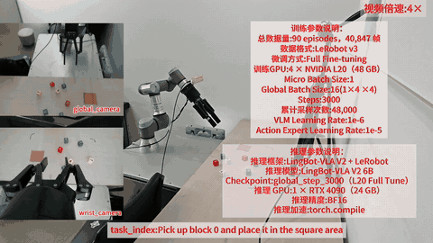
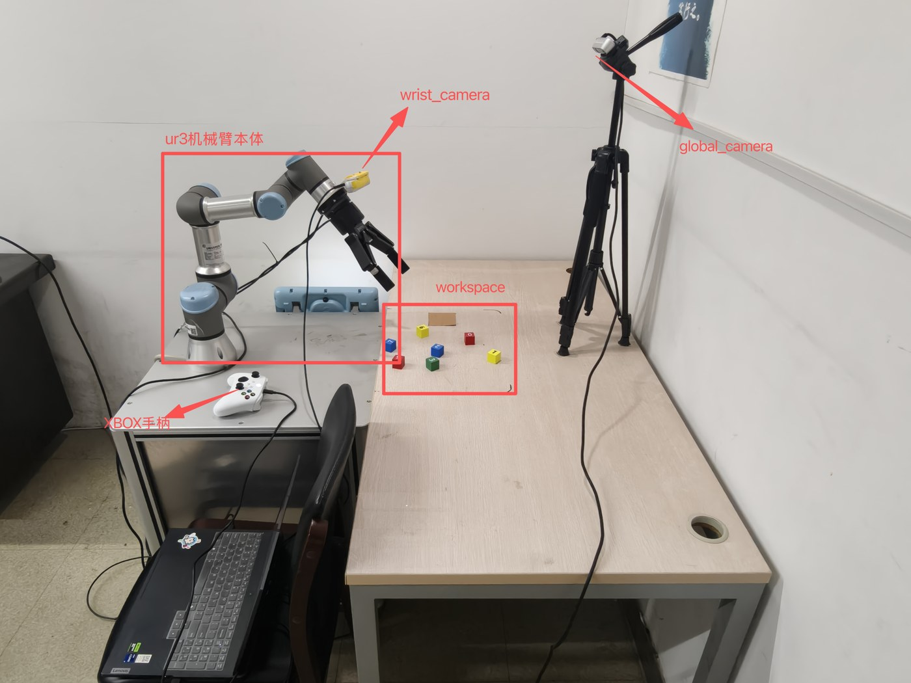
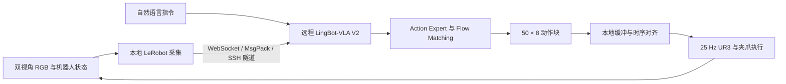
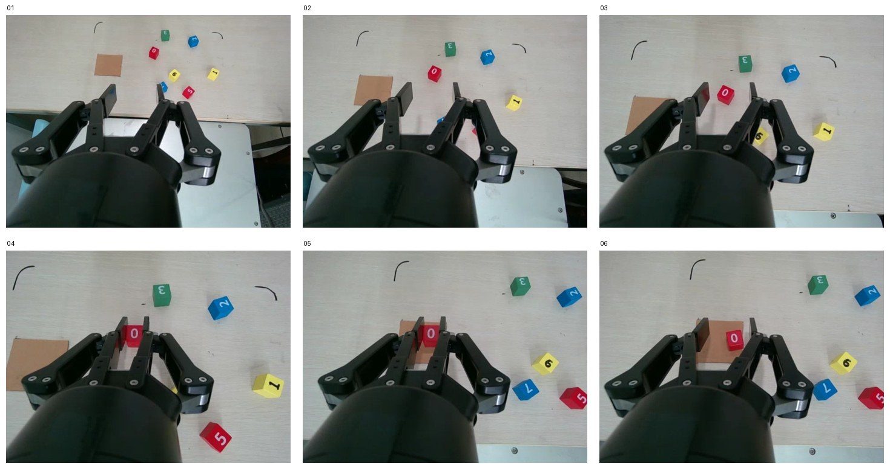

# 基于 LingBot-VLA V2 的多模态感知与自主操作项目

**自然语言指令抓取｜双视角示教｜视觉—语言—动作模型后训练｜远程推理与本地控制**

## 项目介绍

本项目基于 **LingBot-VLA V2 6B** 具身智能模型，构建自然语言指令驱动的机械臂自主操作系统，实现数字积木的语义识别、自主抓取与放置，并通过真实机器人操作任务评估 VLA 模型的任务适应与泛化表现。系统以 **LeRobot** 为基础，在 Universal Robots **UR3** 机械臂与 **Robotiq 2F-140** 夹爪平台上，结合全局与腕部两路 RGB 图像、自然语言指令及机器人状态，预测连续末端动作，完成接近、抓取、搬运和放置。

## 主要工作与实验效果

基于 **LeRobot** 搭建 UR3 机械臂双视角示教系统，采集 **90 条 Episodes（40,847 帧）**真机数据，完成 **17 维 State** 与 **8 维相对 EEF Action** 的数据适配。基于 **LingBot-VLA V2 6B** 模型，采用 **FSDP、BF16 和梯度检查点**技术，在 **4 × L20 GPU** 上完成 **10,000 Steps 全参数微调**。

自主开发 **WebSocket 异步推理与 25 Hz 本地闭环控制系统**，实现 **50 步 Action Chunking** 预测、时序对齐与过期动作丢弃。模型推理与本地动作执行分别运行，通过动作缓冲衔接网络推理和机械臂控制。

在本轮数字 **0、2、6** 三类任务的 **30 次连续真机试验**中，完成 **23 次**完整任务，成功率 **76.7%**；其中包含 **2 次无人工介入的纠错重抓后成功**。

## 演示视频

[](media/ur3-demo-web.mp4)

**[查看完整演示视频 · 720p / 约 9 MB](media/ur3-demo-web.mp4)** · **[下载高清原视频 · 1080p / 约 116 MB](https://github.com/gzk1117/lingbotvla2.0_posttrain/releases/download/demo-2026-10-26/lingbot_vla_v2_demo_original.mp4)** · **[视频与资料发布页](https://github.com/gzk1117/lingbotvla2.0_posttrain/releases/tag/demo-2026-10-26)**

上方动图为演示片段，完整视频时长约 **1 分 18 秒**。原提交视频已标注 **4× 播放速度**；网页压缩版保留原片全部内容、音频、字幕及播放时序，没有再次加速。高清原视频以 Release 附件保存。

## 真机任务

示例指令为 `Pick up block 0 and place it in the square area.`。机械臂需要在多个数字积木中接近指令指定的目标，完成抓取并将其放入桌面方框区域。只抓起目标而没有完成放置不计为成功；同一次试验内自主重抓并完成放置计入该次成功。

<p align="center">
  
</p>

<p align="center"><em>UR3、Robotiq 夹爪、全局相机、腕部相机、Xbox 示教手柄与桌面工作区</em></p>

| 硬件与环境 | 配置 |
| --- | --- |
| 机械臂 | Universal Robots UR3，6 自由度 |
| 夹爪 | Robotiq 2F-140 |
| 全局相机 / 腕部相机 | Intel RealSense D435i / D455 |
| 视觉输入 | 双路 RGB，640 × 480 |
| 示教输入 | Xbox 手柄，TCP 六维位姿与夹爪控制 |
| 本地控制 | Ubuntu 22.04.5、LeRobot、UR RTDE、RS485 / Modbus RTU |
| 本地动作执行频率 | 25 Hz，目标周期 40 ms |

## 数据与后训练

使用自采集的 `ur3_eef_relative_20261016` 真机数据集，包含 **90 条双视角示教轨迹、40,847 帧**，数字 0、2、6 各 30 条。数据按 LeRobot v3 格式保存，以完整 episode 划分为 **81 条训练轨迹和 9 条验证轨迹**，每类分别为 27 条和 3 条。

| 项目 | 配置 |
| --- | --- |
| 基础模型 | LingBot-VLA V2 6B |
| 训练设备 | 4 × L20 GPU |
| 微调方式 | 全参数微调，更新视觉编码器、语言主干、动作专家及投影 / 辅助模块 |
| 训练步数 | **10,000 Steps** |
| 分布式与精度 | FSDP、BF16、梯度检查点 |
| 单卡 Micro Batch Size | 1 |
| 梯度累积步数 | 4 |
| Global Batch Size | **16 = 1 × 4 × 4**（单卡 Micro Batch Size × GPU 数 × 梯度累积步数） |
| 优化器 | AdamW |
| 动作训练目标 | Flow Matching |

训练从 LingBot-VLA V2 6B 预训练权重初始化，通过全参数更新适配自采集的 UR3 双视角真机数据，并结合相对末端动作表示完成机器人平台适配。Global Batch Size 表示每次优化器更新累计使用的样本数；按 **10,000 次优化器更新**计算，累计样本呈现次数为 **160,000（16 × 10,000）**，其中包含同一数据样本在不同更新步骤中的重复使用。

## 动作适配与部署链路

原始观测状态为 **17 维实际反馈**，包括关节角、TCP 位置、旋转向量、四元数及夹爪位置；映射时去除重复的旋转向量表示，保留 14 个有效维度。动作标签为 **8 维**：基坐标系下的三维平移增量、末端局部相对四元数 `xyzw`，以及夹爪绝对位置命令。模型内部使用 55 维统一空间和有效维度 mask，推理输出恢复为 **50 × 8** 动作块。



系统将网络推理与本地控制循环异步运行，处理新动作块的时序对齐、过期动作丢弃及单步限幅。**25 Hz 是本地动作执行频率，模型预测频率低于该值。**平移目标按 `p_target = p_obs + Δp_base` 重建，姿态按 `R_target = R_obs × ΔR` 重建；夹爪命令是 `[0, 1]` 的绝对位置目标。相对动作标签使用 `subtract_state: false`，避免重复做差。

## 真机结果

| 目标数字 | 成功 / 试验次数 | 成功率 | 失败现象 |
| --- | --- | --- | --- |
| 0 | 8 / 10 | 80.0% | 2 次中途掉落 |
| 2 | 7 / 10 | 70.0% | 2 次中途掉落、1 次目标选择错误 |
| 6 | 8 / 10 | 80.0% | 2 次中途掉落 |
| **合计** | **23 / 30** | **76.7%** | **6 次掉落、1 次目标选择错误** |

30 次为完整连续试验，执行过程均无人工介入。数字 0、2 各有 1 次纠错重抓后成功，已计入 23 次成功，不额外增加试验次数。上述比例对应本轮三类任务的小样本评测，不代表对任意目标、布局或场景的泛化结果。

<p align="center">
  
</p>
<p align="center"><em>一次完整抓取与放置：从左到右、从上到下为初始化、接近、对齐、抓取、搬运和放置</em></p>

## 项目材料

README 按当前项目进展更新，原始报告保留提交时的阶段性实验记录。

- [完整技术报告（Markdown 图文版）](docs/technical-report.md)
- [原始项目说明（PDF，11 页）](docs/UR3_RealRobot_Demo_Report.pdf)
- [演示视频与来源说明](media/README.md)
- [高清原视频 Release](https://github.com/gzk1117/lingbotvla2.0_posttrain/releases/tag/demo-2026-10-26)

```text
lingbotvla2.0_posttrain/
├── README.md
├── docs/
│   ├── technical-report.md          # 修复图片链接的完整图文说明
│   ├── UR3_RealRobot_Demo_Report.pdf # 原始 PDF
│   └── images/                     # 平台、双视角与执行过程图片
└── media/
    ├── README.md                   # 视频版本、播放速度与来源
    ├── ur3-demo-web.mp4             # 完整 720p 展示版
    └── ur3-demo-preview.gif         # 首页片段预览
```

当前公开内容为真机项目说明、展示图片及演示视频，训练源代码、示教数据集和模型权重不在这份材料归档内。

## 相关项目

[LingBot-VLA V2](https://github.com/Robbyant/lingbot-vla-v2) · [LeRobot](https://github.com/huggingface/lerobot)
