# 真机 Demo 项目说明

 
## 1. 项目基本信息

- **团队名称：** Mind in Motion
- **Demo 名称：** 基于 LingBot-VLA V2 的 UR3 数字积木指令抓取与放置系统
- **使用机器人本体：** Universal Robots UR3（6 自由度），搭配 Robotiq 2F-140 夹爪
- **使用模型版本：** LingBot-VLA V2 6B
- **项目类别：** 真机创新任务
- **技术框架：** LeRobot + LingBot-VLA V2
- **本轮评测模型：** L20 全参数微调的 `global_step_3000`

团队基于 90 条双视角示教轨迹，分别完成 4 × RTX 4090 局部微调和 4 × L20 全参数微调，并集成真机采集、远程推理与本地动作执行；本轮全部使用 L20 全参数微调的 `global_step_3000`，以抓取并放置到指定区域为成功终点，成功 **23/30（76.7%）**，包含 2 次纠错重抓后成功，分项结果见第 4 章。

### 1.1 设备与系统环境

| 类别 | 设备／配置 | 用途 |
|---|---|---|
| 机械臂 | Universal Robots UR3，6 自由度 | 桌面抓取与移动 |
| 末端执行器 | Robotiq 2F-140 夹爪 | 抓取及释放数字积木 |
| 全局相机 | Intel RealSense D435i | 观察桌面、目标及放置区域 |
| 腕部相机 | Intel RealSense D455 | 观察末端与局部抓取状态 |
| 示教输入设备 | Xbox 手柄 | TCP 六维位姿与夹爪控制、人工示教采集，映射见 3.1 |
| 真机控制计算机 | Ubuntu 22.04.5，LeRobot 框架 | 相机／机器人状态采集、25 Hz 动作执行 |
| 局部微调计算资源 | 4 × RTX 4090（每卡 24 GB） | VLM 最后四层与动作模块联合微调 |
| 全参数微调计算资源 | 4 × NVIDIA L20（48 GB 级） | VLA 主策略全参数微调 |
| 远程推理计算资源 | RTX 4090 服务器中的单张 GPU | 加载模型并输出动作块 |

真机侧使用 UR RTDE 连接 UR3，通过 USB-RS485 / Modbus RTU 控制夹爪。两路 RGB 图像输入分辨率均为 **640 × 480**。

<p align="center">
  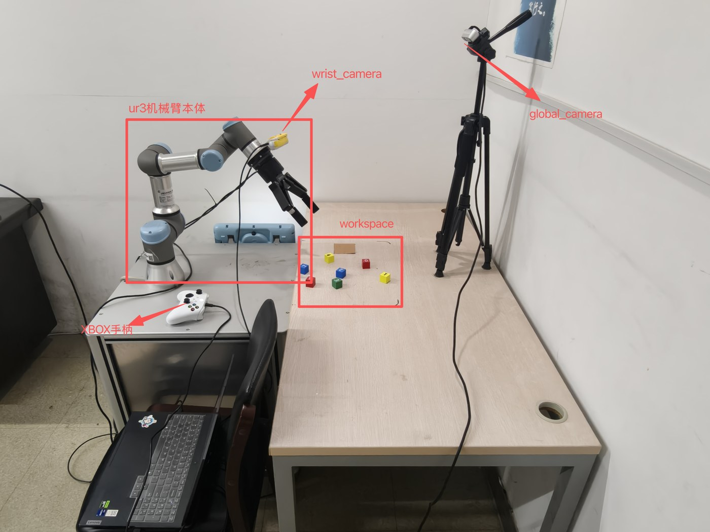
</p>

<p align="center"><strong>图 1｜UR3 数字积木操作平台与双相机布置</strong></p>

图中标注了 UR3 机械臂本体、腕部相机、全局相机、Xbox 示教手柄及桌面工作区；工作区内放置数字积木和方形目标区域。

## 2. 任务说明

### 2.1 任务目标

构建**自然语言指令驱动的数字积木抓取与放置系统**。机械臂根据指令，从桌面数字积木中选择 **0、2、6** 之一，将其抓取并放入指定方框区域。

示例指令：`Pick up block 0 and place it in the square area.`

目标执行流程为：**理解指令与目标数字 → 利用视觉观测接近目标 → 下探并闭合夹爪 → 搬运 → 指定区域放置**。抓取正确目标并完成指定区域放置才计为成功，纠错重抓后完成同一任务也计为成功。

### 2.2 应用场景

项目面向真实机器人桌面操作，探索视觉、语言与连续动作融合在指令分拣、指定区域搬运等场景中的应用，并验证通用 VLA 模型在 UR3 平台上的适配能力。

### 2.3 挑战点

1. **指令与视觉目标对应。** 在同一桌面存在多个数字积木时，需要根据语言选择正确目标，并协调全局与腕部视角；早期试验出现过指令目标与实际接近对象不一致的情况。
2. **有限示教数据下的任务适配。** 数据共 90 条轨迹、每类 30 条，需要在有限数据与显存条件下适配模型；对新摆位、视角和光照的泛化仍需受控验证。
3. **真实机器人动作空间对齐。** 将 UR3 状态、相对末端动作和夹爪目标映射到模型内部空间，保持坐标系、四元数及归一化处理在采集、训练和部署中的一致性。
4. **远程推理与本地控制协调。** 模型按块预测动作，本地以 25 Hz 执行，需要处理网络延迟、动作时序对齐与过期动作。
5. **稳定夹持与失败后的继续执行。** 中途掉落是本轮主要失败现象，需要检查闭爪时序、夹持状态及搬运动作；本轮已观察到 2 次无人工介入的纠错重抓并完成放置。

## 3. 数据与训练

### 3.1 数据来源与采集方式

使用团队在 UR3 + Robotiq 真机平台上采集的自有双视角示教数据集 **`ur3_eef_relative_20261016`**，按 LeRobot v3 格式保存。

<p align="center">
  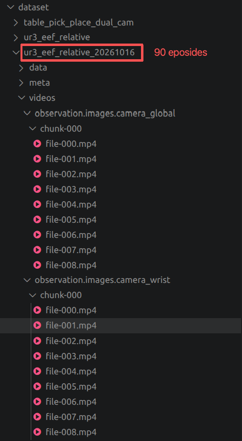
</p>

<p align="center"><strong>图 2｜数据集目录结构</strong></p>

数据集 `ur3_eef_relative_20261016` 包含 90 条 episode，以及 `data`、`meta` 和 `videos` 目录；双视角视频分别保存在 `observation.images.camera_global` 与 `observation.images.camera_wrist` 下。

**采集方式：** 操作者通过 Xbox 手柄进行人工示教，直接控制 TCP 的三维平移、三维旋转和夹爪，同时记录双路图像及机器人状态与动作。

**Xbox 六维控制及按键映射：**

| 操作 | 功能 |
|---|---|
| 左摇杆左右 | TCP X 平移；向右为 −X |
| 左摇杆上下 | TCP Y 平移；向下为 +Y |
| 右摇杆上下 | TCP Z 平移；向上为 +Z |
| RB＋左摇杆左右 | 绕 Z 轴旋转；向右为负 |
| LB＋右摇杆左右 | 绕 X 轴旋转；向右为正 |
| LB＋右摇杆上下 | 绕 Y 轴旋转；向下为正 |
| LT | 张开夹爪到配置位置 0.5 |
| RT | 闭合夹爪到 1.0 |
| Y | 回到配置的 home |
| A | 提前结束并保存当前 episode |
| X | 放弃并重录当前 episode |
| B | 停止录制 |

RB 将左摇杆横向输入从 X 平移切换为 Z 旋转；LB 将右摇杆纵向输入从 Z 平移切换为 Y 旋转。RB、LB 是模式修饰键，不是使能或暂停键。摇杆输入采用线性比例，默认死区为 **0.05**。

| 项目 | 数据 |
|---|---|
| 任务种类 | 抓取数字 0、2、6 并放入指定区域，共 3 类 |
| 示教轨迹 | 90 条，每类 30 条 |
| 总帧数 | 40,847 帧 |
| 记录频率 | 25 Hz |
| 总数据时长 | 约 27.23 分钟 |
| 训练／验证划分 | 81／9 条 episode（36,688／4,159 帧） |
| 视觉数据 | 全局及腕部两路 RGB，640 × 480，MP4 视频 |
| 状态与动作 | Parquet；任务和 episode 信息以元数据保存 |

采用**按完整 episode 分组**的训练／验证划分，随机种子为 42，避免同一轨迹的不同帧同时出现在训练与验证中。每类任务包含 27 条训练轨迹和 3 条验证轨迹。该数据集为真机自有数据，不属于 RoboTwin 仿真数据集。

**图 3｜双视角采集样例**

| （a）全局相机采集画面 | （b）腕部相机采集画面 |
|:---:|:---:|
| 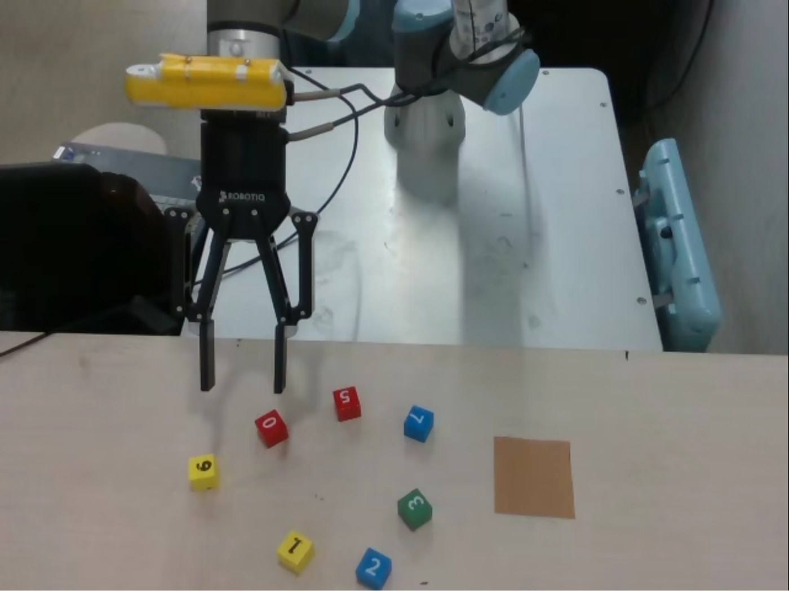 | 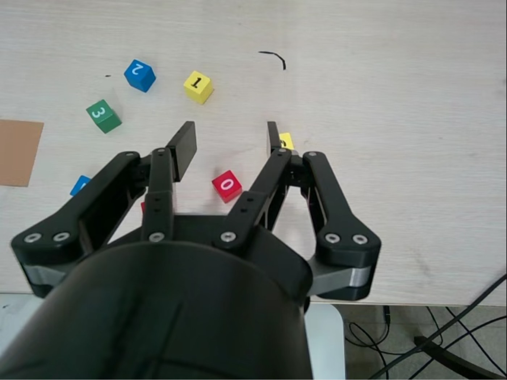 |

全局视角展示机械臂、桌面数字积木及放置区域；腕部视角展示夹爪与附近积木，提供末端局部信息。

### 3.2 状态与动作定义

**观测状态 `observation.state`：17 维，均为实际反馈值。**

```text
[6 维实际关节角,
 3 维实际 TCP 位置,
 3 维实际 TCP 旋转向量,
 4 维实际 TCP 四元数 xyzw,
 1 维实际夹爪位置]
```

映射到模型前保留 14 个有效维度，去除与四元数重复的旋转向量表示。

**动作标签 `action`：8 维。**

```text
[Δx, Δy, Δz, Δqx, Δqy, Δqz, Δqw, gripper]
```

- **平移：** 单位为米，采用机器人基坐标系下的增量。
- **旋转：** 四元数顺序为 `xyzw`，表示末端局部相对旋转，保存时统一为 `qw ≥ 0`；无旋转时为 `[0, 0, 0, 1]`。重建目标姿态使用 `R_target = R_obs × ΔR`。
- **夹爪：** `gripper` 是范围 `[0, 1]` 的绝对位置命令，不是位置增量；`0` 为全开，`0.5` 为本次配置的半开目标，`1` 为闭合目标。动作中的夹爪目标与 state 中的实际夹爪位置含义不同。

**动作预测窗口：50 步。** 在 25 Hz 下对应 2 秒的预测时域；25 Hz 是本地动作执行频率，不表示模型每秒更新 25 次预测。

通过机器人适配器将状态和动作映射到 LingBot-VLA V2 的 **55 维内部空间**，并以有效维度 mask 区分填充数据；推理后恢复为 `50 × 8` 的机器人动作。由于标签已是相对 EEF 动作，预处理设置 `subtract_state: false`，避免重复做差。


### 3.3 训练／调优方法

在相同任务数据基础上实施两种**独立训练实验**，均由 LingBot-VLA V2 6B 预训练权重初始化。

| 项目 | 方案 A：RTX 4090 局部微调 | 方案 B：L20 全参数微调 |
|---|---|---|
| 训练设备 | 4 × RTX 4090 | 4 × L20 |
| 可训练范围 | Qwen 语言层 32–35、动作专家、投影／辅助模块；视觉编码器冻结 | 视觉编码器、语言主干、动作专家及投影／辅助模块全部更新 |
| 可训练参数 | 约 23.42 亿 | 约 63.76 亿 |
| 图像输入 | 双路 640 × 480 | 双路 640 × 480 |
| 分布式方案 | FSDP2、BF16、梯度检查点 | FSDP2、BF16、梯度检查点、激活 CPU 卸载 |
| micro batch / 梯度累积 | 每卡 1 / 4 | 每卡 1 / 4 |
| 全局 batch | 16 | 16 |
| 训练步数 | 5,000 | 3,000 |
| 训练耗时 | 约 25 小时 24 分钟（含初始化与导出） | 约 19 小时 22 分钟（完整运行记录） |
| 优化器 | AdamW | AdamW |
| VLM / 专家 / 其他模块峰值学习率 | 1e-6 / 1e-5 / 2e-5 | 1e-6 / 1e-5 / 2e-5 |
| 学习率调度 | 预热 + constant | 预热 + cosine |

动作训练采用 **Flow Matching** 目标。本轮真机评测使用 L20 全参数微调完成后导出的 `global_step_3000`，第 4 章全部效果均对应这一检查点。

主要调优措施包括：

1. **显存适配：** FSDP2 分片参数、梯度和优化器状态，结合 BF16、梯度检查点及 micro batch = 1；L20 全参数训练进一步启用激活 CPU 卸载。
2. **视觉输入适配：** 保留 640 × 480 原始非方形双视角图像，移除无效相机占位，保持训练与推理的图像输入配置一致。
3. **训练与部署一致性：** 固定数据划分、相机键映射、相对动作定义、四元数预处理与训练集归一化统计；导出 HF 推理权重，保留训练恢复使用的 DCP 检查点。

### 3.4 本轮模型的训练结果

4090 局部微调虽完成训练并降低了离线误差，但真机推理中仍出现目标数字选错、停留在目标上方、空抓等问题，无法完成预期的抓取与放置任务。因此，团队改用 L20 全参数微调，进一步解冻视觉编码器、语言主干与动作模块，并采用 `global_step_3000` 完成本轮真机评测。

| 指标 | 已完成结果 | 解释与边界 |
|---|---|---|
| 4090 局部微调总 Loss | 前 100 步均值 0.741434 → 后 100 步 0.111958 | 训练目标明显下降 |
| 4090 局部微调离线平移 RMSE | 5,000 步：**3.709 mm**；保持不动基线：6.110 mm | 基于 9 条留出验证轨迹，表示动作标签误差，不是末端物体定位误差 |
| 4090 单卡离线推理 | 预热后约 **0.789 s/次**（BF16，未编译） | 对应局部微调 5,000 步模型 |
| L20 全参数微调总 Loss | 前 100 步均值 0.575146 → 后 100 步 0.120276 | 3,000 步训练完整结束，损失下降约 79.09% |
| L20 全参数微调显存 | 四 rank 最大 allocated **31.298 GiB** | 已导出 1,000、2,000、3,000 步三个 HF 模型 |

**本轮评测只使用 L20 全参数微调的 `global_step_3000`**，权重部署在 RTX 4090 服务器上进行推理。训练设备与推理设备不同，不改变检查点来源。训练 Loss 用于描述训练过程，真机任务效果以第 4 章的 30 次试验为准。


## 4. Demo 效果

### 4.1 执行流程

Demo 采用“本地 LeRobot 控制 + 远端 LingBot-VLA V2 推理”的架构，**全程使用 L20 全参数微调的 `global_step_3000` 推理**。运行链路如下。

1. **输入任务：** 指定目标数字及放置区域，例如抓取数字 0 并放入方框。
2. **采集观测：** 本地控制机读取全局及腕部 RGB 图像、17 维机器人状态。
3. **预测动作：** 将观测与语言指令发送至远端的 `global_step_3000` 模型，输出 `50 × 8` 相对末端动作块。
4. **执行与更新：** 本地控制循环按 25 Hz 执行模型输出的位姿与夹爪动作，并更新观测用于后续推理；整个任务过程无人工介入。
5. **记录结果：** 正确目标被抓取并放置到指定区域计为成功；同一次试验中纠错重抓后完成放置也计为成功，重抓不额外增加试验次数。

**图 4｜一次真实模型运行的连续帧：抓取数字 0 并放置到指定区域**

<table width="100%">
  <tr>
    <td width="33%" align="center" valign="top">
      <strong>① 初始化</strong><br>
      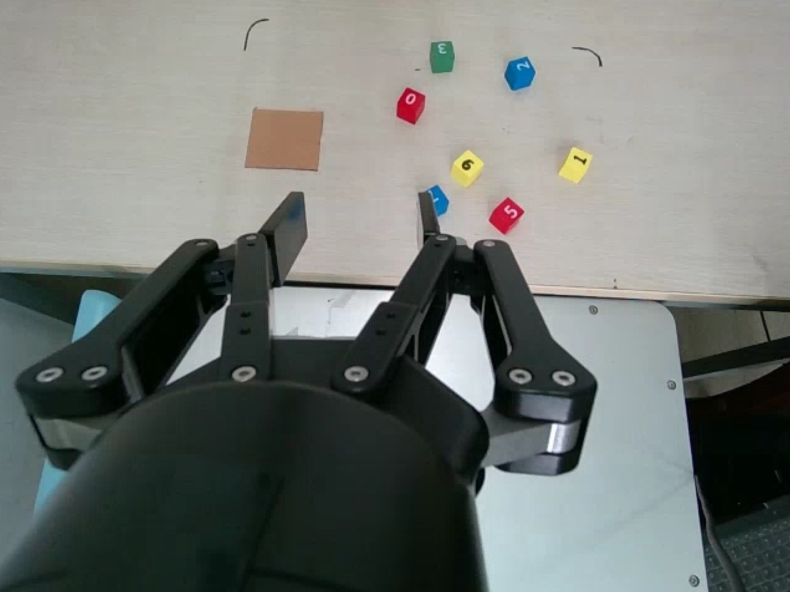<br>
      夹爪张开，观察桌面场景
    </td>
    <td width="33%" align="center" valign="top">
      <strong>② 接近目标</strong><br>
      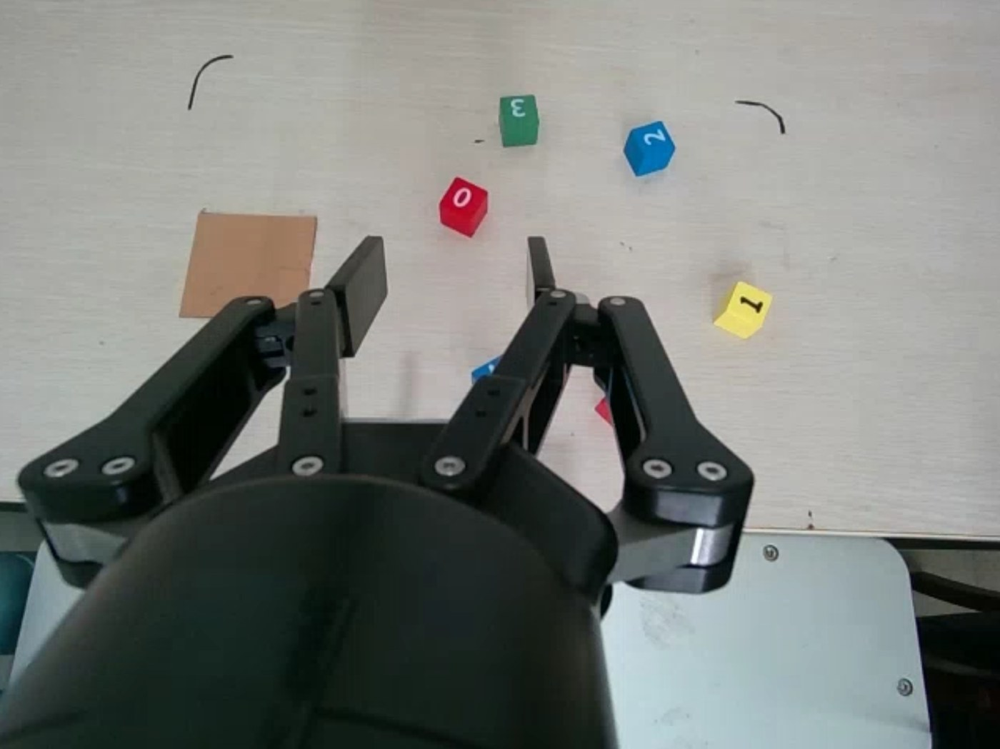<br>
      向红色数字 0 移动
    </td>
    <td width="33%" align="center" valign="top">
      <strong>③ 进一步靠近</strong><br>
      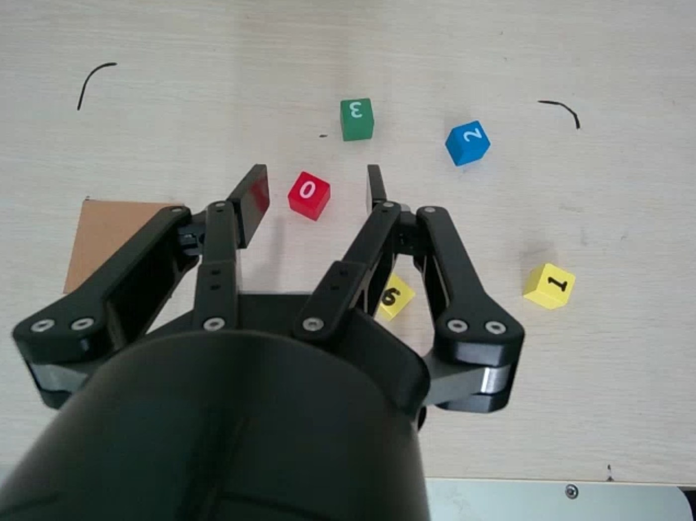<br>
      保持张开，进一步靠近数字 0
    </td>
  </tr>
  <tr>
    <td width="33%" align="center" valign="top">
      <strong>④ 闭爪抓取</strong><br>
      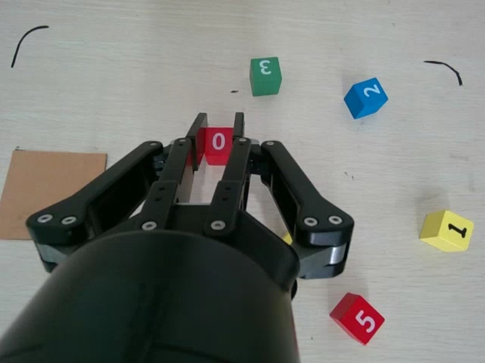<br>
      闭合夹爪，夹持数字 0
    </td>
    <td width="33%" align="center" valign="top">
      <strong>⑤ 搬运至指定区域</strong><br>
      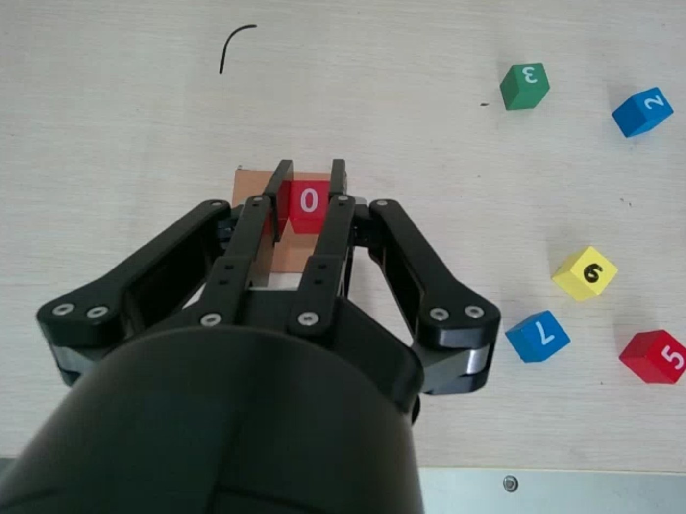<br>
      保持夹持，移动至方形区域上方
    </td>
    <td width="33%" align="center" valign="top">
      <strong>⑥ 松爪放置</strong><br>
      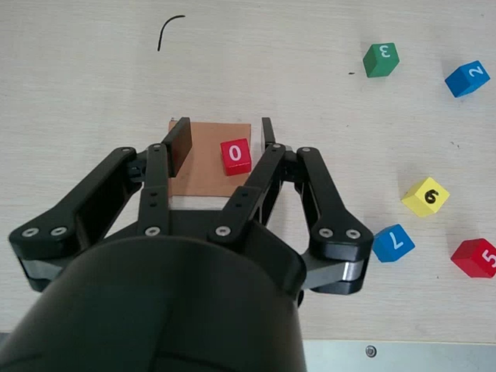<br>
      张开夹爪，数字 0 留在指定区域
    </td>
  </tr>
</table>

图中为同一次任务执行的腕部相机连续阶段画面，按从左到右、从上到下的顺序阅读。**L20 全参数微调 `global_step_3000` 真机推理。**

### 4.2 最终效果与成功次数／尝试次数

**评测对象：** L20 全参数微调的 `global_step_3000`，在 UR3 + Robotiq 平台上执行数字 0、2、6 三类指令任务，**每类 10 次，共 30 次完整连续试验，全部无人工介入**。成功终点统一为抓取正确目标并放置到指定区域，纠错重抓后完成放置计入成功。

| 目标数字 | 成功／总次数 | 失败／总次数 | 成功率 | 失败现象 | 纠错重抓记录 |
|:---:|---:|---:|---:|---|---|
| **0** | **8/10** | 2/10 | **80.0%** | 2 次中途掉落 | 其中 1 次首次夹错后重新抓取并完成放置，已计入 8 次成功 |
| **2** | **7/10** | 3/10 | **70.0%** | 2 次中途掉落；1 次夹错目标数字 | 其中 1 次纠错重抓并完成放置，已计入 7 次成功 |
| **6** | **8/10** | 2/10 | **80.0%** | 2 次中途掉落 | — |
| **合计** | **23/30** | **7/30** | **76.7%** | **6 次掉落；1 次目标选择错误** | **数字 0、2 各 1 次重抓成功，共 2 次，均已计入 23 次成功** |

总体比例按上述 30 次试验合并计算：

$$
\text{本轮任务成功率}=\frac{8+7+8}{10+10+10}\times100\%=76.7\%
$$

**统计口径：**

- **成功终点：** 抓取指令指定的正确数字积木，并放置到指定区域；仅抓起但未完成放置不计成功。
- **试验与重抓计数：** 按一次任务执行计一次试验，同一次试验内允许纠错重抓；重抓后完成放置计入该次成功，不新增试验次数。
- **连续性与人工介入：** 30 次为完整连续试验，执行过程无人工介入；2 次成功重抓也无人工介入。


### 4.3 结果分析与恢复案例

1. **三类目标均有成功记录。** 分项结果见上表。这些是本轮小样本观察结果；是否体现语言条件选择及新场景泛化，还需结合布局变化和对照记录判断。
2. **观察到 2 次纠错重抓成功。** 数字 0 有 1 次首次夹错后重新抓取成功，数字 2 有 1 次纠错重抓成功，分别计入 8 次和 7 次成功。
3. **掉落是主要失败现象。** 7 次失败中有 6 次中途掉落，占失败样本的 **85.7%**；另有 1 次目标选择错误。后续优先核查夹持稳定性、闭爪位置与时序、抬升／搬运速度及目标选择。这些是待验证方向，尚不能作为已完成的故障归因。


## 5. 技术方案

### 5.1 感知方案

使用全局相机与腕部相机的两路 RGB 图像，分别提供桌面任务场景与末端局部信息。模型结合图像、自然语言指令和机器人状态进行动作预测。视觉语言主干采用 **Qwen3-VL**，提取任务相关表征。

### 5.2 推理方案

远端加载 **L20 全参数微调的 `global_step_3000`**。LingBot-VLA V2 的动作专家通过 **Flow Matching** 预测后续 50 步连续动作，包含位置、旋转及夹爪目标。远端 GPU 负责模型推理，本地 Ubuntu 控制机负责设备 I/O、状态反馈读取与动作执行。

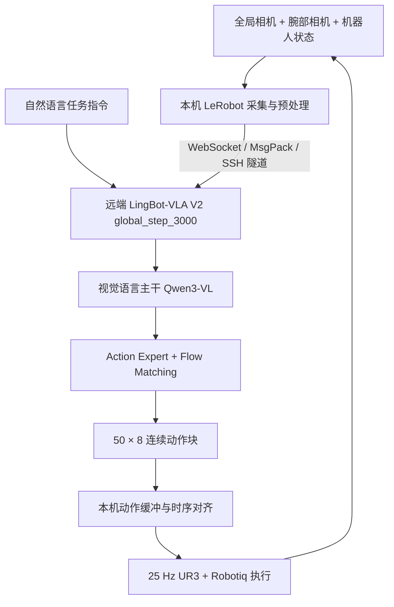


双方使用 **WebSocket + MessagePack/NumPy** 通信，通过 **SSH 端口转发**建立隧道，并采用 `permessage-deflate` 对消息进行无损压缩。

### 5.3 真机适配方式

**动作空间适配：** 按第 3.2 节定义映射状态与相对 EEF 动作，平移目标使用 `p_target = p_obs + Δp_base`，姿态目标使用 `R_target = R_obs × ΔR`，夹爪使用绝对位置目标，保持训练和执行中的坐标系与四元数处理一致。

**异步调度：** 网络推理与本地 25 Hz（40 ms/步）控制循环分离；新动作块到达后进行请求时序对齐、丢弃过期动作，并执行单步限幅。25 Hz 表示本地动作执行频率，模型预测频率低于该值。

**夹爪控制：** 模型动作中的 `gripper` 按 `[0, 1]` 绝对位置命令解释，由本地夹爪接口执行；state 则记录实际夹爪位置。本轮抓取与放置均使用同一 `global_step_3000` 的动作预测。

### 5.4 本轮运行配置与实测效果

| 项目 | 本轮配置或结果 |
|---|---|
| 模型来源 | L20 全参数微调的 `global_step_3000` |
| 推理设备 | RTX 4090 服务器中的单张 GPU |
| 本地动作执行频率 | 25 Hz，目标周期 40 ms |
| 模型动作预测窗口 | 50 步，输出 `50 × 8` 动作块 |
| 执行方式 | 全程执行模型推理输出，无模型与预设动作分段控制 |
| 试验记录 | 完整连续 30 次，无人工介入 |
| 完整任务成功率 | 23/30，76.7%，以抓取正确目标并放置到指定区域为准 |
| 纠错重抓成功 | 2 次，数字 0、2 各 1 次，已计入成功次数 |

### 5.5 主要技术探索

1. **UR3 状态与动作适配。** 将真实机器人 relative EEF + 四元数动作与 LingBot-VLA V2 内部空间对齐，贯通 LeRobot 示教、VLA 训练与真机推理。
2. **两种微调方案的实践。** 在双路 640 × 480 真机数据上，分别完成 VLM 高层局部解冻与全参数微调；真机性能差异仍需等条件比较。
3. **远程推理与本地执行集成。** 组合异步推理、动作缓冲、25 Hz 本地控制与无损压缩，将 `global_step_3000` 推理输出用于完整任务执行。
4. **多目标操作与纠错恢复。** 完成三类目标共 30 次连续的真机试验，以指定区域放置为统一成功终点，成功 23 次，其中包含 2 次纠错重抓后成功。


